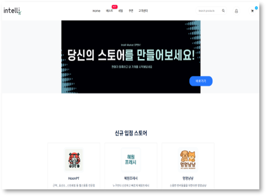
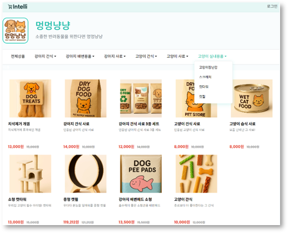
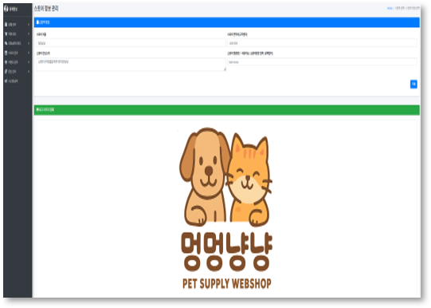
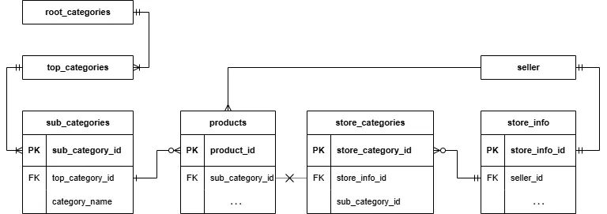
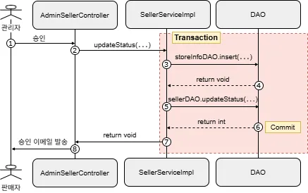

# Intelli Market | 판매자 맞춤형 오픈마켓 플랫폼

> 이 저장소는 [hye000ne/intellimarket](https://github.com/hye000ne/intellimarket) 팀 프로젝트를 fork한 저장소입니다.
> 제가 담당한 기여 내용을 중심으로 이 README를 새로 작성했습니다. 팀 프로젝트 원본 소개와 팀원 구성은 원본 저장소를 참고해 주세요.

---

## 프로젝트 개요

`2025.07 - 2025.08` · 4인 팀(팀장) · 백엔드 담당

**[기획 배경]**
오픈마켓은 판매자별로 스토어명, 로고, 카테고리 구성이 상이해 화면과 데이터를 판매자 단위로 유연하게 관리할 구조가 필요합니다.
스토어·카테고리·상품 정보를 코드에 고정하지 않고 DB 기반으로 관리해, 신규 판매자 입점 시 코드 수정 없이 스토어 운영이 가능하도록 설계했습니다.

**[담당 역할]**
판매자·스토어·카테고리·상품 ERD 설계, 스토어 관리 기능 및 스토어 정보 JSP 렌더링 구현, 판매자 신청 폼·요청 처리 구현

**Tech Stack**
`Java` `Spring MVC` `MyBatis` `MySQL` `JSP`

**[구현 화면]**

| 메인 페이지 | 판매자 스토어 (담당) | 판매자 - 스토어 관리 (담당) |
| :---: | :---: | :---: |
|  |  |  |

---

## Trouble Shooting

<b>🔧 1. 스토어 카테고리 삭제 검증과 비즈니스 무결성</b> (클릭하여 펼치기)

 

**[문제]**
`products`는 `sub_categories`를 참조하지만, 판매자의 취급 카테고리(`store_categories`)는 상품과 FK로 연결되지 않은 구조였습니다.
카테고리 삭제 시 DB 제약만으로는 사용 여부를 검증할 수 없어, 사용 중인 카테고리도 삭제 가능한 정합성 문제가 발생했습니다.

**[해결]**
카테고리 삭제 요청 시 해당 판매자의 상품을 조회하여 삭제 대상 `sub_category_id` 사용 여부를 사전 검증했습니다.
사용 중인 상품이 존재하면 `StoreCategoryException`에 상품명을 포함해 반환하고 삭제를 중단하도록 구현했습니다.

**[관련 ERD 다이어그램]**

**[결과 및 한계]**
삭제 후 상품이 스토어에서 노출되지 않는 정합성 문제를 예방하고, 삭제 불가 사유를 상품명과 함께 제공하여 사용자 조치 편의성을 높였습니다.
다만 현재는 삭제 요청마다 판매자의 전체 상품을 조회하는 구조로, 상품 수 증가 시 `EXISTS` 기반 조회로 개선 가능한 여지가 있습니다.

**[회고]**
스키마 설계의 결함은 불필요한 조인과 이를 보완하기 위한 서비스 로직 추가로 이어져, 프로젝트의 성능과 안정성에 영향을 준다는 것을 체감했습니다.
그러나 진행 중인 프로젝트에서의 스키마 변경은 엔티티, Mapper, 서비스 로직 등 여러 영역의 수정을 동반해 적용이 어려운 만큼,
꼼꼼한 초기 설계와 비즈니스 도메인 이해의 중요성을 배우는 계기가 되었습니다.

관련 코드: [`StoreCategoryServiceImpl.java`](src/main/java/com/intellimarket/store/service/StoreCategoryServiceImpl.java)

<b>🔧 2. 판매자 승인 시 스토어 중복 생성 방지</b> (클릭하여 펼치기)

 

**[문제]**
판매자 승인 시 `sellers` 상태 변경과 `store_info` 생성이 별개의 쓰기 작업으로 분리되어 있는 구조였습니다.
초기 구현 시 트랜잭션 없이 두 작업을 순차적으로 처리했고, 중간에 예외가 발생하면 `sellers` 상태는 `APPROVED`로 변경됐지만
`store_info`는 생성되지 않는 불일치 상태가 발생했습니다.

**[해결]**
`SellerServiceImpl.updateStatus`에 `@Transactional`을 적용해 "판매자 상태 변경 + `store_info` 생성"을 하나의 트랜잭션으로 묶었습니다.
예외 발생 시 두 작업이 함께 롤백되어 상태 불일치가 발생하지 않도록 원자성을 보장했습니다.

**[시퀀스 다이어그램(성공 케이스)]**

**[결과 및 한계]**
승인 처리 도중 예외가 발생해도 판매자 상태와 스토어 존재 여부가 어긋나지 않습니다.
`PENDING` 상태에서는 `store_info`가 생성되지 않아, 미승인 판매자의 스토어가 노출되는 상황을 방지했습니다.

**[회고]**
트랜잭션으로 원자성은 보장했지만, `store_info.seller_id`에 `UNIQUE` 제약이 없어 중복 승인 요청 시 `store_info`가 중복 생성될 가능성은 남아 있습니다.
서비스 로직만으로는 동시 요청이나 예외 경로를 완전히 막기 어려운 만큼, DB 제약(UNIQUE/NOT NULL 등)과 서비스 레이어 검증을 함께 두는 것이
안전한 설계임을 체감했습니다.

관련 코드: [`SellerServiceImpl.java`](src/main/java/com/intellimarket/store/service/SellerServiceImpl.java)

---
이 프로젝트를 Spring Boot + JPA 구조로 개인 리팩토링한 후속 프로젝트는 [Intelli Market v2](https://github.com/rekindle402/IntelliMarket_v2)에서 진행 중입니다.

## Contact
- Email: [rekindle402@gmail.com](mailto:rekindle402@gmail.com)
